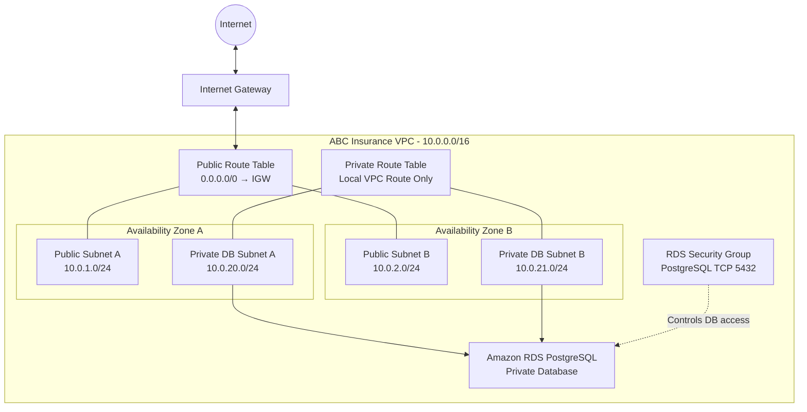

# 02 – AWS Network Architecture

## 1. Architecture Overview

ABC Insurance will use a dedicated Amazon Virtual Private Cloud (VPC) to establish an isolated networking environment for its cloud resources.

The architecture is designed around three principles:

1. **Network isolation:** Separate resources based on their purpose and exposure.
2. **High availability:** Distribute network resources across multiple Availability Zones.
3. **Security:** Keep database resources private and restrict network access.

The initial design uses one VPC across two Availability Zones in the AWS US East (N. Virginia) Region (`us-east-1`).

This is a learning architecture, not a production deployment.

## 2. High-Level Network Architecture

### 2.1 Proposed Architecture Diagram



**Diagram notes:**

- The VPC is the overall isolated network.
- Public subnets are intended for future internet-facing components or controlled network access exercises.
- Private database subnets are intended for RDS.
- The RDS database will not receive direct internet access.
- The diagram shows the planned logical design, not deployed resources.

## 3. VPC Design

The project will use one dedicated VPC.

| Configuration | Planned value |
|---|---|
| VPC name | abc-insurance-vpc |
| AWS Region | us-east-1 |
| IPv4 CIDR | 10.0.0.0/16 |
| IPv6 | Not configured initially |
| Tenancy | Default |

### Why 10.0.0.0/16?

An IPv4 CIDR block of `/16` provides:

- 65,536 total IPv4 addresses.
- Sufficient address space for multiple subnet ranges.
- Flexibility for future application and database resources.

The VPC address range is much larger than the initial subnet requirements. This leaves room for future expansion.

## 4. Subnet Architecture

The VPC will initially contain four subnets distributed across two Availability Zones.

### 4.1 Subnet Allocation

| Subnet | Type | Availability Zone | CIDR |
|---|---|---|---|
| Public Subnet A | Public | AZ A | 10.0.1.0/24 |
| Public Subnet B | Public | AZ B | 10.0.2.0/24 |
| Private DB Subnet A | Private | AZ A | 10.0.20.0/24 |
| Private DB Subnet B | Private | AZ B | 10.0.21.0/24 |

Each `/24` subnet contains 256 total IPv4 addresses. AWS reserves five addresses in every IPv4 subnet, leaving 251 usable addresses.

### 4.2 Why Two Availability Zones?

Using two Availability Zones helps the architecture support high availability.

For example:

- If one Availability Zone experiences an infrastructure problem, another AZ remains available.
- RDS can use a DB subnet group containing subnets from both AZs.
- A Multi-AZ RDS deployment can place a standby database in another AZ.

Important: Creating subnets in two Availability Zones does not automatically enable RDS Multi-AZ. The database deployment configuration must explicitly enable it.

### 4.3 Why Separate Public and Private Subnets?

Public and private subnets serve different purposes.

**Public subnets**

Intended for components that may need controlled internet connectivity, such as a future public-facing application component.

**Private database subnets**

Intended for resources that should not be directly reachable from the public internet.

The RDS database will be placed in private database subnets.

A subnet is considered public when its associated route table provides a route to an Internet Gateway. Assigning a public IPv4 address alone does not make a subnet public.

## 5. Internet Gateway

An Internet Gateway (IGW) provides a connection between a VPC and the public internet.

Planned configuration:

- One Internet Gateway.
- Attached to the ABC Insurance VPC.
- Used by public subnet route tables.

The public route table will contain:

| Destination | Target |
|---|---|
| 10.0.0.0/16 | local |
| 0.0.0.0/0 | Internet Gateway |

The `local` route allows resources within the VPC to communicate using the VPC's internal routing.

The `0.0.0.0/0` route directs traffic for other IPv4 destinations toward the Internet Gateway.

An Internet Gateway does not automatically expose every resource in the VPC to the internet. Public addressing, routing, security groups, and other controls also matter.

## 6. Route Table Design

The project will use separate route tables for public and private subnets.

### 6.1 Public Route Table

Purpose: Provide internet routing for public subnets.

| Destination | Target |
|---|---|
| 10.0.0.0/16 | local |
| 0.0.0.0/0 | Internet Gateway |

Subnet associations:

- Public Subnet A
- Public Subnet B

### 6.2 Private Database Route Table

Purpose: Keep database subnets isolated from direct internet routing.

| Destination | Target |
|---|---|
| 10.0.0.0/16 | local |

Subnet associations:

- Private DB Subnet A
- Private DB Subnet B

No NAT Gateway is planned initially.

The database subnets do not need direct internet access for the initial database exercise.

## 7. Security Architecture

Security will be implemented at multiple networking layers.

### 7.1 Security Groups

Security groups control traffic entering and leaving associated AWS resources.

Planned RDS security group:

| Configuration | Planned value |
|---|---|
| Name | abc-insurance-rds-sg |
| Protocol | TCP |
| Port | 5432 |
| Source | Authorized application or administration security group |

Port 5432 is the default PostgreSQL port.

The source will be restricted to authorized systems. We will not use `0.0.0.0/0` as the database inbound source.

Security groups are stateful, so response traffic for permitted connections is automatically allowed.

### 7.2 Network ACLs

Network ACLs provide an additional subnet-level traffic control layer.

We will explore:

- Inbound rules.
- Outbound rules.
- Allow and deny rules.
- Rule numbers and evaluation order.
- Stateless traffic handling.

Network ACLs are stateless. Return traffic must be permitted by the appropriate rules.

For the initial exercise, we will avoid unnecessarily restrictive custom NACL rules until we understand the traffic requirements.

## 8. RDS Placement Architecture

Amazon RDS PostgreSQL will be deployed in private database subnets.

A DB subnet group will include:

- Private DB Subnet A.
- Private DB Subnet B.

The DB subnet group provides RDS with subnet choices across Availability Zones.

The initial database design will explore:

- Single-AZ deployment.
- Multi-AZ deployment.
- Database instance class.
- Storage type and allocated storage.
- Automated backups.
- Database endpoint.
- Security group configuration.

We will compare the cost and availability implications before selecting a deployment configuration.

## 9. Network Traffic Flow

### 9.1 Public Subnet Traffic

A resource in a public subnet may communicate with the internet when the required conditions are met:

1. Its subnet is associated with a route table containing a route to the Internet Gateway.
2. The resource has an appropriate public IPv4 address or other suitable public connectivity.
3. Its security group and network ACL permit the required traffic.

### 9.2 Private Database Traffic

The database will accept connections only from authorized sources.

Example:

```text
Authorized Application
          |
          | TCP 5432
          v
    RDS Security Group
          |
          v
   Private RDS Database
```

The database will not have a public route through an Internet Gateway.

For later Mac-to-database connectivity exercises, we will choose an appropriate secure access method rather than making the database publicly accessible by default.

## 10. Cost Considerations

The initial networking design aims to avoid unnecessary charges.

| Component | Expected pricing treatment |
|---|---|
| VPC | No additional charge |
| Subnets | No additional charge |
| Route tables | No additional charge |
| Internet Gateway | No hourly charge |
| Security groups | No additional charge |
| Network ACLs | No additional charge |
| NAT Gateway | Hourly and data-processing charges |
| RDS instance | Compute charges while running |
| RDS storage | Storage charges |
| Data transfer | May incur charges depending on traffic and destination |

We will not create a NAT Gateway during the initial networking exercise.

Actual AWS pricing depends on region, configuration, and usage.

## 11. Future Architecture Enhancements

After completing the initial design, we may explore:

- Application subnets.
- NAT Gateway and NAT instances.
- VPC endpoints.
- VPC peering.
- Transit Gateway concepts.
- VPC Flow Logs.
- RDS Proxy.
- Aurora PostgreSQL.
- AWS Systems Manager Session Manager for secure administration.

These are learning topics, not part of the initial deployment.

## 12. Implementation Status

| Component | Status |
|---|---|
| Architecture design | Planned |
| VPC | Not created |
| Public subnets | Not created |
| Private DB subnets | Not created |
| Internet Gateway | Not created |
| Route tables | Not configured |
| Security groups | Not configured |
| DB subnet group | Not created |
| RDS PostgreSQL | Not created |

This document will be updated as the actual AWS configuration is implemented and validated.

---

**Next document:** `03-vpc-design.md` – Detailed VPC CIDR planning, configuration choices, and implementation evidence.
